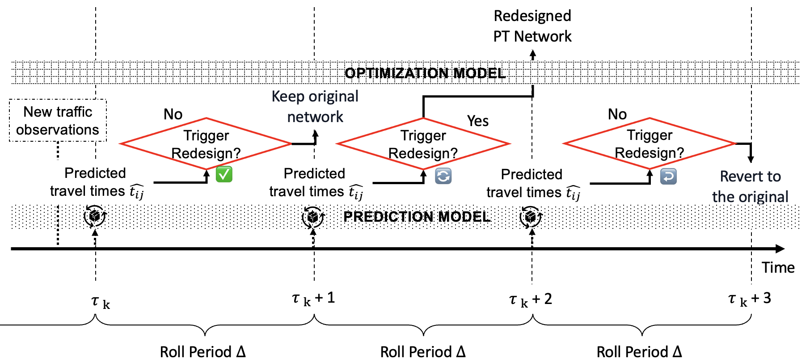

# Predict-then-Optimize Framework for Public Transport Line Redesign under Fluctuating Traffic Conditions

Submission to The 17th International Conference on Advanced Systems in Public Transport (CASPT2027). The full paper is available on [arXiv](https://arxiv.org/pdf/2608.11405).

**Authors:** Zihao Guo¹, Andrea Araldo¹\*, Fayçal Touzout², Mounim El-Yacoubi¹

¹ Institut Polytechnique de Paris, Palaiseau 91120, France  
² National School of State Public Works, Marne-la-Vallée 77454, France  
\* Corresponding author

## Summary

Bus lines are usually designed for nominal traffic and then left as they are. We study what happens when they are instead redesigned proactively, about one hour ahead, whenever link travel times are forecast to deviate strongly from nominal conditions. The redesign is deliberately limited: lines stay close to those already in service, which preserves operational continuity and keeps the network usable for passengers, while user and operator performance are maintained. The whole procedure is a predict-then-optimize loop. Lines are optimized on noisy forecasts and evaluated on the realized travel times.

## Files

- `main.tex`: LaTeX source of the condensed conference version.
- [`suppl/suppl.pdf`](suppl/suppl.pdf): supplementary material, compiled separately from `suppl/main.tex`.
- [`code/`](code/): artifacts, to be released upon acceptance.

## Data

- [Mandl's network](https://people.brunel.ac.uk/~mastjjb/jeb/orlib/utraninfo.html): benchmark network and demand (OR-Library).
- [Beijing network](https://github.com/BUPTAIOC/Transportation/tree/main/A%20Multi-objective%20Ant%20Colony%20System-based%20Approach%20to%20Transit%20Route%20Network%20Adjustment/The%20Problem%20Instances%20of%20A%20Large%20Scale%20Public%20Transit%20Route%20Network%20): bus network and demand, from Wu et al. (2024).
- [METR-LA](https://github.com/liyaguang/DCRNN): traffic speeds, used for Mandl's network.
- [Q-Traffic](https://github.com/JingqingZ/BaiduTraffic): traffic speeds and road network, used for the Beijing network.
